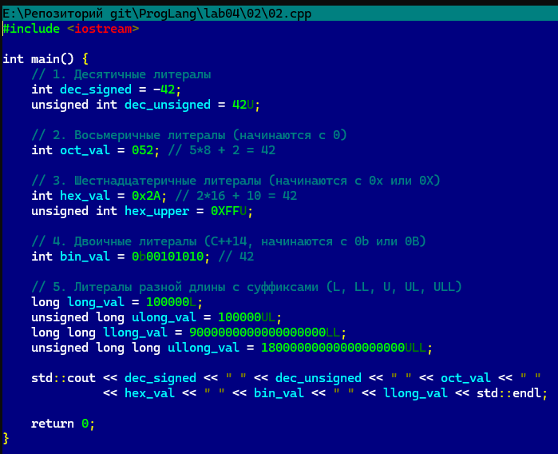
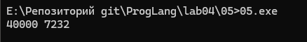
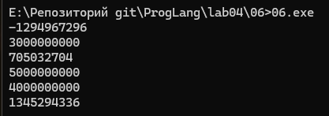
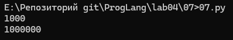

## Отчёт по лабораторной работе 4

### Задание 1 **(3)**
**1. Двоичное представление числа $-99$ в целочисленном знаковом типе в дополнительном коде:**

* Число $99_{10}$ в двоичном виде: $01100011_2$.
1) Длиной 1 байт (8 бит):
2) Прямой код: 01100011
3) Поразрядная инверсия (~): 10011100
4) Прибавление 1 (+1): 10011101 (в hex: 0x9D)

* Длиной 2 байта (16 бит):
1) 11111111 10011101 (в hex: 0xFF9D)

* Длиной 4 байта (32 бита):
1) 11111111 11111111 11111111 10011101 (в hex: 0xFFFFFF9D)

**2. Литералы наибольшего и наименьшего числа типа int (32-битный signed int) в 16-ричной записи:**

* Наибольшее число (INT_MAX = $2^{31} - 1 = 2\,147\,483\,647$): 0x7FFFFFFF
* Наименьшее число (INT_MIN = $-2^{31} = -2\,147\,483\,648$): -0x80000000 (или -0x7FFFFFFF - 1)

**3. Двоичное представление символа # в типе char:**

* Код символа # в ASCII равен $35_{10}$.
* $35_{10} = 32 + 2 + 1 = 00100011_2$.
* В 8-битном char: 00100011.

### Задание 2 **(3)**
**Программа на C++, демонстрирующая большинство способов записи целочисленных литералов:**



### Задание 3 **(2)**

```
char a = 'a';
a = a + 10;
std::cout << a;
a = a + 250;
std::cout << a;
```

**Объяснение работы:**

1. char a = 'a'; — переменной a присваивается символ 'a', ASCII-код которого равен $97_{10}$ (в hex: 0x61).
2. a = a + 10; — к коду $97$ прибавляется $10$, получается $107$. По таблице ASCII код $107_{10}$ соответствует символу k.
3. std::cout << a; — выводит символ k.
4. a = a + 250; — вычисляется $107 + 250 = 357$.
* В C++ тип char обычно является знаковым (signed char), занимающим 1 байт (8 бит) со значением от $-128$ до $127$.
* Арифметика над 8-битными знаковыми числами происходит по модулю $256$:

### Задание 4 **(2)**

**Программа на Python:**
```
a = ord('a')       # Код 'a' = 97
a = a + 10          # 107
print(chr(a), end='') # Выведет 'k'

a = a + 250         # 107 + 250 = 357
print(chr(a), end='') # Выведет 'ſ'
```

.png)

**Причина отличия вывода:**

1. В Python тип int не ограничен 8 битами и не подвержен знаковым переполнениям по модулю $256$.
2. Функция chr() в Python работает с полной таблицей Unicode (code points). Символ с Юникод-кодом $357_{10}$ ($0x0165$) — это ſ (латинская строчная длинная «s» — Latin Small Letter Long S), а не переполненный ASCII-код $101$ (e), как произошло в C++.

### Задание 5. **(2)**

```
unsigned short x = 40000;
unsigned short y = x + x;
unsigned short z = x * 2;
y = y - x;
z = z / 2;
std::cout << y << " " << z << std::endl;
```



**Объяснение и вычисления:**

Тип unsigned short — 16-битное беззнаковое целое с диапазоном от $0$ до $65535$. Все операции выполняются по модулю $2^{16} = 65536$.

1. y = x + x = 40000 + 40000 = 80000.
* Из-за переполнения 16 бит: $80000 \pmod{65536} = 80000 - 65536 = 14464$.
* Переменная y принимает значение $14464$.
2. z = x * 2 = 80000.
* $80000 \pmod{65536} = 14464$.
* Переменная z принимает значение $14464$.
3. y = y - x = 14464 - 40000 = -25536.
* В беззнаковой арифметике: $-25536 \pmod{65536} = 65536 - 25536 = 40000$.
* Значение y возвращается к $40000$.
* Почему $x+x-x = x$: Операция вычитания является точной обратной операцией к сложению в кольце вычетов по модулю $2^{16}$.
4. z = z / 2 = 14464 / 2 = 7232.
* Почему $(x \cdot 2) / 2 \neq x$: В процессе умножения $40000 \cdot 2$ произошла отброс старшего (17-го) бита из-за ограничения в 16 бит. Деление на 2 просто сдвигает оставшиеся биты вправо и не может восстановить утерянный старший бит.

### Задание 6 **(2)**

```
std::cout << 2000000000 + 1000000000 << std::endl;
std::cout << 2000000000U + 1000000000U << std::endl;
std::cout << 2500000000U + 2500000000U << std::endl;
std::cout << 2500000000LL + 2500000000LL << std::endl;
std::cout << 20000U * 200000U << std::endl;
std::cout << 200000U * 200000U << std::endl;
```



**Вычисления для каждой строки до запуска:**

1. 2000000000 + 1000000000
* Операнды типа signed int (32 бита, макс. $2\,147\,483\,647$).
* $2\,000\,000\,000 + 1\,000\,000\,000 = 3\,000\,000\,000$.
* Происходит знаковое переполнение в 32 битах:
$$3\,000\,000\,000 - 2^{32} = 3\,000\,000\,000 - 4\,294\,967\,296 = -1\,294\,967\,296$$
* Результат: -1294967296

2. 2000000000U + 1000000000U
* Операнды типа unsigned int (32 бита, макс. $4\,294\,967\,295$).
* $3\,000\,000\,000 < 4\,294\,967\,295$, переполнения нет.
* Результат: 3000000000

3. 2500000000U + 2500000000U
* Операнды типа unsigned int.
* $2\,500\,000\,000 + 2\,500\,000\,000 = 5\,000\,000\,000$.
* Беззнаковое переполнение по модулю $2^{32}$:
$$5\,000\,000\,000 - 4\,294\,967\,296 = 705\,032\,704$$
* Результат: 705032704

4. 2500000000LL + 2500000000LL
* Операнды типа long long (64 бита).
* $5\,000\,000\,000$ свободно вмещается в 64-битный тип.
* Результат: 5000000000

5. 20000U * 200000U
* Операнды unsigned int.
* $20\,000 \times 200\,000 = 4\,000\,000\,000 \le 4\,294\,967\,295$.
* Переполнения нет.
* Результат: 4000000000

6. 200000U * 200000U
* Операнды unsigned int.
* $200\,000 \times 200\,000 = 40\,000\,000\,000$.
* Беззнаковое переполнение по модулю $2^{32}$:
$$40\,000\,000\,000 \pmod{4\,294\,967\,296} = 40\,000\,000\,000 - 9 \times 4\,294\,967\,296 = 1\,345\,294\,336$$
* Результат: 1345294336

### Задание 7 **(2)**

**Разложим $1000$ в сумму степеней двойки:**
$$1000 = 512 + 256 + 128 + 64 + 32 + 8 = 2^9 + 2^8 + 2^7 + 2^6 + 2^5 + 2^3$$

**Программа на Python:**

.png)

**Итог программы:**



### Задание 8 **(2)**

*Найдите результаты вычисления следующих выражений без использования компьютера
или калькулятора. Процесс вычислений должен быть отображен в отчете.*
* `(1000 & 100) << 10`
* `(1000 >> 4) & 15`
* `~1234 + 1234`
* `(1000 ^ 500) & 63`
* `(100 << 3) + (100 >> 3)`

###  Задание 9 **(2)**
*Напишите программу на языке С++ для умножения заданного целого числа на* $-1$. *В программе можно использовать только сложение и битовые
операции. Условия, циклы, библиотечные функции использовать нельзя.*

## Дополнительные задания

### Задание 1 **(3)**

*Какие значения можно присвоить целочисленной переменной* **x**,
*чтобы результатом выражения `x|(x+1)` стало число 895?
Найдите все значения без использования компьютерных вычислений. 
Обоснуйте ответ.*

### Задание 2 **(3)**

*Какие значения можно присвоить целочисленной переменной* **x**,
*чтобы результатом выражения `x&(x-1)` стало число 0?
Найдите все значения без использования компьютерных вычислений 
(среди них есть отрицательные числа). Обоснуйте ответ.*

### Задание 3 **(3)**
*Какие значения можно присвоить целочисленной переменной* **x**,
*чтобы результатом выражения `x|(2*x)` стало число 1975?
Найдите все значения без использования компьютерных вычислений. 
Обоснуйте ответ.*

### Задание 4 **(3)**
*Обоснуйте корректность работы программы "Разложение числа по степеням двойки" из лекции.
Требуется определить, что будет результатом выражения `x&-x`.*

### Задание 5 **(5)**
*Ответьте на вопросы по программе "Упаковка коротких чисел" из лекции.*

* *Можно ли указанным способом сохранить более 8 чисел? Обоснуйте ответ.*
* *Сколько чисел можно будет сохранить при изменении диапазона от 0 до 7? Обоснуйте ответ.*
* *В чем смысл <<магической>> константы 15 в тексте программы?*
* *Если по условию задачи надо будет сохранить только числа в интервале от 0 до 10, то следует ли заменить
эту константу на 10? Обоснуйте ответ.*

### Задание 6 **(3)**
*Рассмотрим следующую программу на языке Python. Сколько чисел она выводит в зависимости от введенного
значения* **x**? *Как полученные числа зависят от* **x**?
```
x = int(input())
i = x
while i>0:
   print(i)
   i = (i-1) & x
```
