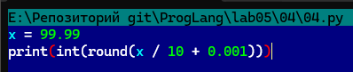
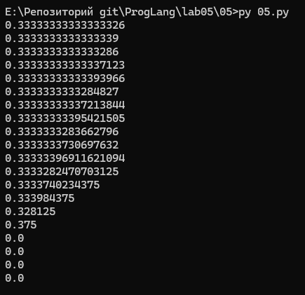
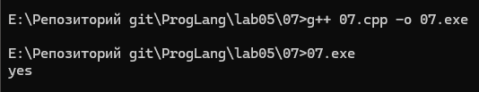
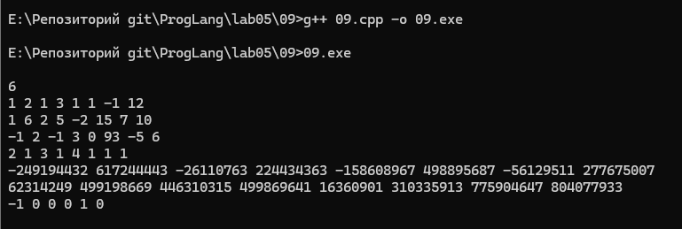

## Отчет по лабораторной работе 5

### Задание 1 **(2)**
#### 1. Число со знаменателем 32: $X_1 = \frac{27}{32}$

Разложим числитель по степеням двойки:
$$27 = 16 + 8 + 2 + 1 = 2^4 + 2^3 + 2^1 + 2^0$$
Тогда дробь равна:
$$\frac{27}{32} = \frac{16}{32} + \frac{8}{32} + \frac{2}{32} + \frac{1}{32} = 2^{-1} + 2^{-2} + 2^{-4} + 2^{-5}$$
Процесс последовательного умножения на 2:
* $27/32 \times 2 = 54/32 = 1 + 22/32$ (целая часть: **1**)
* $22/32 \times 2 = 44/32 = 1 + 12/32$ (целая часть: **1**)
* $12/32 \times 2 = 24/32 = 0 + 24/32$ (целая часть: **0**)
* $24/32 \times 2 = 48/32 = 1 + 16/32$ (целая часть: **1**)
* $16/32 \times 2 = 32/32 = 1 + 0$ (целая часть: **1**, остаток 0)

**Ответ:** $\frac{27}{32} = 0.11011_2$ (конечная двоичная дробь).

#### 2. Число со знаменателем от 9 до 12: $X_2 = \frac{7}{10} = 0.7$
Процесс последовательного умножения на 2 для поиска периода:
* $0.7 \times 2 = 1.4$ $→$ целая часть **1**, остаток $0.4$
* $0.4 \times 2 = 0.8$ $→$ целая часть **0**, остаток $0.8$
* $0.8 \times 2 = 1.6$ $→$ целая часть **1**, остаток $0.6$
* $0.6 \times 2 = 1.2$ $→$ целая часть **1**, остаток $0.2$
* $0.2 \times 2 = 0.4$ $→$ целая часть **0**, остаток $0.4$ (остаток $0.4$ повторился — начало периода!)

**Ответ:** $\frac{7}{10} = 0.1(0110)_2$ (периодическая дробь с периодом длины 4: $0110$).

### Задание 2 **(3)**
Выберем число **$113.7$** ($>100$, цифра после запятой 7).

#### 1. Перевод целой части:
$$113_{10} = 64 + 32 + 16 + 1 = 1110001_2$$

#### 2. Перевод дробной части:
$$0.7_{10} = 0.1011001100110011..._2 = 0.1(0110)_2$$

#### 3. Объединение и нормализация:
$$113.7_{10} = 1110001.1011001100110011..._2 = 1.110001101100110011001100..._2 \times 2^6$$
Сдвиг запятой влево произошел на **6** позиций.

#### 4. Параметры формата IEEE 754 Double Precision (64 бита):
* **Знак ($S$, 1 бит):** число положительное $\implies S = 0$.
* **Порядок ($E$, 11 бит):** 
  $$E = \text{порядок} + \text{bias} = 6 + 1023 = 1029_{10} = 10000000101_2 \text{ (0x405)}$$
* **Мантисса ($M$, 52 бита):**
  Ведущая единица отбрасывается.
  Первые 6 бит: `110001` (от целой части).
  Далее повторяется период: `1011 0011 0011 0011...`
  Запишем первые 53 бита после единицы:
  `1100 0110 1100 1100 1100 1100 1100 1100 1100 1100 1100 1100 1100` (52 бита)
  53-й бит равен `1`, 54-й `1` $\implies$ по правилу округления к ближайшему четному к младшему разряду мантиссы прибавляется `1`:
  `...1100` $\rightarrow$ `...1101`.

#### 5. Сборка 64 бит:
* Двоичный вид:
  `0` `10000000101` `1100011011001100110011001100110011001100110011001101`

### Задание 3 **(3)**
#### Пара 1: $A = 1.0011_2 \times 2^{18}$, $B = 1.1001_2 \times 2^{21}$
1. **Сумма:**
   * Выравнивание порядков ($\Delta = 21 - 18 = 3$): $A = 0.0010011_2 \times 2^{21}$.
   * Сложение мантисс:
     $$1.1001000_2 + 0.0010011_2 = 1.1011011_2$$
   * **Ответ:** $1.1011011_2 \times 2^{21}$ (или `1.1011011e21`).
2. **Произведение:**
   * Порядок: $18 + 21 = 39$.
   * Мантиссы: $1.0011_2 \times 1.1001_2 = (19 \times 25) / 256 = 475 / 256 = 1.11011011_2$.
   * **Ответ:** $1.11011011_2 \times 2^{39}$ (или `1.11011011e39`).

---

#### Пара 2: $A = 1.1011_2 \times 2^{-25}$, $B = 1.1101_2 \times 2^{-23}$
1. **Сумма:**
   * Выравнивание ($\Delta = -23 - (-25) = 2$): $A = 0.011011_2 \times 2^{-23}$.
   * Сложение: $1.110100_2 + 0.011011_2 = 10.001111_2$.
   * Нормализация: сдвиг вправо на 1 разряд, порядок увеличивается на 1:
     $$10.001111_2 \times 2^{-23} = 1.0001111_2 \times 2^{-22}$$
   * **Ответ:** $1.0001111_2 \times 2^{-22}$ (или `1.0001111e-22`).
2. **Произведение:**
   * Порядок: $-25 + (-23) = -48$.
   * Мантиссы: $1.1011_2 \times 1.1101_2 = (27 \times 29) / 256 = 783 / 256 = 11.00001111_2$.
   * Нормализация: сдвиг на 1 разряд вправо, порядок $-48 + 1 = -47$:
     $$1.100001111_2 \times 2^{-47}$$
   * **Ответ:** $1.100001111_2 \times 2^{-47}$ (или `1.100001111e-47`).

---

#### Пара 3: $A = 1.1011_2 \times 2^{-3}$, $B = 1.1011_2 \times 2^{1}$
1. **Сумма:**
   * Выравнивание ($\Delta = 1 - (-3) = 4$): $A = 0.00011011_2 \times 2^{1}$.
   * Сложение: $1.10110000_2 + 0.00011011_2 = 1.11001011_2$.
   * **Ответ:** $1.11001011_2 \times 2^1$ (или `1.11001011e1`).
2. **Произведение:**
   * Порядок: $-3 + 1 = -2$.
   * Мантиссы: $1.1011_2 \times 1.1011_2 = (27 \times 27) / 256 = 729 / 256 = 10.11011001_2$.
   * Нормализация: сдвиг на 1 разряд вправо, порядок $-2 + 1 = -1$:
     $$1.011011001_2 \times 2^{-1}$$
   * **Ответ:** $1.011011001_2 \times 2^{-1}$ (или `1.011011001e-1`).

### Задание 4 **(2)**

```
>>> x = 99.99
>>> int(x/10+0.001)
9
```
#### Причина:
**Число 99.99 не представимо конечно в двоичной системе счисления и сохраняется в IEEE 754 как приближенное значение $99.989999999999994884...$.**

**При вычислениях:**
$$x / 10 + 0.001 = 9.998999999999999 + 0.001 = 9.999999999999998...$$
**Функция int() производит усечение к нулю (отбрасывание дробной части). Поскольку результат строго меньше $10$, получается 9.**

#### Как исправить:

**Использовать округление round():**



### Задание 5. **(2)**

```
x = 1/3
y = 1
for i in range(20):
    print((x+y)-y)
    y*=10
```



#### Объяснение и оценка погрешности:
**Мантисса типа double содержит 53 бита точности ($\approx 15\text{--}17$ десятичных цифр).**
**Машинное эпсилон $\varepsilon_{mach} = 2^{-52} \approx 2.22 \times 10^{-16}$.**
**При сложении $x + y$, где $y \gg x$, мантисса $x$ сдвигается вправо. При каждом умножении $y$ на 10 порядок $y$ растет, и младшие разряды $x$ вытесняются за пределы 53-битной сетки мантиссы (поглощаются).**

* При $y \approx 10^{16}$ минимальный шаг сетки мантиссы равен $y \cdot 2^{-52} \approx 10^{16} \cdot 2.22 \cdot 10^{-16} \approx 2.22$
* Так как $x = 1/3 \approx 0.333 < 2.22$, число $x$ полностью вытесняется и округляется до 0.
* В результате $x + y$ становится строго равно $y$, а $(x + y) - y = 0.0$.

### Задание 6 **(2)**

```
#include <bits/stdc++.h>

int main() {
    int n = 1024;
    double s = pow(2, n);
    std::cout << std::fixed << s << std::endl;
}
```

.png)

**1. Минимальное значение $n$ для double: 1024.**
* В формате IEEE 754 Double максимальное нормализованное число равно $(2 - 2^{-52}) \times 2^{1023} \approx 1.7977 \times 10^{308}$.
* Число $2^{1023}$ еще представимо, а $2^{1024}$ строго превышает максимальный предел $E_{max} = 1023$, что вызывает переполнение (overflow) и превращается в +inf.

**2. Замена double на long double:**
* В MinGW GCC x86_64 тип long double использует 80-битный формат x87 с 15 битами порядка ($E_{max} = 16383$). Переполнение в inf наступит только при $n = 16384$. При $n = 1024$ программа выведет конечное число.

### Задание 7 **(2)**

```
#include <iostream>

int main() {
    double s = 0.0 / 0.0;
    if (s != s)
        std::cout << "yes" << std::endl;
    return 0;
}
```



**Объяснение: По стандарту IEEE 754 значение NaN обладает свойством: любое сравнение с ним (включая равенство самому себе NaN == NaN) возвращает false, а условие s != s возвращает true.**

### Задание 8 **(2)**
1. Минимальное число: $2^{53} + 1 = 9\,007\,199\,254\,740\,993$.
* Мантисса типа double хранит 53 бита точности (52 явных + 1 неявная единица).
* Двоичная запись числа $2^{53} + 1$ имеет вид $1 00\dots00 1_2$ (всего 54 бита). 

*Младшая единица выходит за разрядную сетку мантиссы и отбрасывается округлением (округляется до $2^{53}$). Погрешность составляет $\Delta = 1$.*

2. Почему следующее число $2^{53} + 2$ записывается без погрешности?

$$2^{53} + 2 = 2 \cdot (2^{52} + 1) = (100\dots0010)_2 = 1.00\dots01_2 \times 2^{53}$$

*Младший бит равен 0, поэтому все значащие биты укладываются ровно в 53 бита мантиссы.*

###  Задание 9 **(2)**

.png)



## Отчет по выполненным работам с Olymp.

1. Маршрутка
```
n = int(input())

departed = (n // 15) * 15
left = n % 15

print(departed, left)
```
2. Сумма половин
```
s = input().strip()

mid = len(s) // 2
first_half = int(s[:mid])
second_half = int(s[mid:])

print(first_half + second_half)
```
3. Жажда
```
n = int(input())
print(f"{n / 3:.3f}")
```
4. Рубли и копейки
```
s = input().strip()

if "." in s:
    rub, kop = s.split(".")
    kop = kop.ljust(2, "0")
    print(f"{int(rub)} rub {int(kop)} kop")
else:
    print(f"{int(s)} rub 0 kop")
```
5. Отчет
```
n, m, c, k = map(int, input().split())

total_sheets = n * m
needed_sheets = max(0, total_sheets - k)
packs = (needed_sheets + 199) // 200

print(packs * c)
```
6. Подарки
```
n, m, k = map(int, input().split())

total_candies = n * m
boxes = (total_candies + k - 1) // k

print(boxes)
```
7. Датчик пульса
```
import math

n_str, t_str = input().split()
n = int(n_str)
t = float(t_str)

bpm = math.ceil(n * 60 / t)
print(bpm)
```
8. Точки на прямой
```
import math

x, y = map(float, input().split())

min_val = math.ceil(x)
max_val = math.floor(y)

count = max(0, max_val - min_val + 1)
print(count)
```
9. Буквы и цифры
```
s = input().strip()
ans = sum(int(ch) for ch in s if ch.isdigit())
print(ans)
```
10. Скобки в зазеркалье
```
s = input().strip()

mapping = str.maketrans("()", ")(")
mirrored = s[::-1].translate(mapping)

print(mirrored)
```
11. Разворот слов
```
words = input().split()
reversed_words = [word[::-1] for word in words]
print(" ".join(reversed_words))
```
12. Минимальные делители
```
def get_min_divisor(n):
    for d in range(2, int(n**0.5) + 1):
        if n % d == 0:
            return d
    return n


numbers = list(map(int, input().split()))
results = [get_min_divisor(x) for x in numbers]

print(*results)
```
13. Сумма делителей
```
n = int(input())

total_sum = 1
for d in range(2, int(n**0.5) + 1):
    if n % d == 0:
        total_sum += d
        if d != n // d:
            total_sum += n // d

print(total_sum)
```
14. Игра в пробке
```
n = int(input())

masha = 0
dasha = 0

for _ in range(n):
    plate = int(input())
    if plate % 3 == 0:
        masha += 2
    else:
        dasha += 1

print(f"{masha}:{dasha}")
```
15. Прибыль
```
n = int(input())

max_profit = 0

for _ in range(n):
    income, expense = map(int, input().split())
    profit = income - expense
    if profit > 0:
        max_profit += profit

print(max_profit)
```