# Отчёт по выполненной лабораторной работе
## Лабораторная работа 6

### Задание 1 **(3)**
*Рассмотрим следующую программу на С++.*
```
#include <iostream>
#include <cmath>
int main() {
   double x = 0;
   const auto Pi = std::acos(0) * 2;
   std::cout << Pi << std::endl;
   return 0;
}
```
*Проверьте четыре способа объявления* **Pi**.
**Вариант 1 (const auto Pi = acos(0) * 2;):**

```
#include <iostream>
#include <cmath>

int main() {
    double x = 0;
    const auto Pi = acos(0) * 2;
    std::cout << Pi << std::endl;
    return 0;
}
```

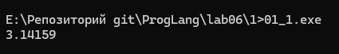

Программа работает. Формально это константа времени выполнения. Но компилятор видит константу 0 и при оптимизации может посчитать Pi заранее.   

**Вариант 2 (constexpr auto Pi = std::acos(0) * 2;):**

```
#include <iostream>
#include <cmath>

int main() {
    double x = 0;
    constexpr auto Pi = std::acos(0) * 2;
    std::cout << Pi << std::endl;
    return 0;
}
```

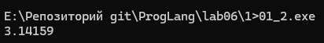

Здесь объявляется настоящая константа этапа трансляции. В компиляторе GCC (g++) эта строка работает, так как компилятор умеет вычислять std::acos(0) на этапе трансляции. В некоторых других компиляторах может возникнуть ошибка, так как математические функции не обязаны быть constexpr по старым стандартам C++.

**Вариант 3 (const auto Pi = acos(x) * 2;):** 

```
#include <iostream>
#include <cmath>

int main() {
    double x = 0;
    const auto Pi = acos(x) * 2;
    std::cout << Pi << std::endl;
    return 0;
}
```

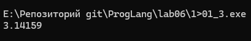

Программа работает. Переменная x может меняться, поэтому Pi вычисляется во время работы программы. Это не константа этапа трансляции.

**Вариант 4 (constexpr auto Pi = std::acos(x) * 2;):**

```
#include <iostream>
#include <cmath>

int main() {
    double x = 0;
    constexpr auto Pi = std::acos(x) * 2;
    std::cout << Pi << std::endl;
    return 0;
}
```

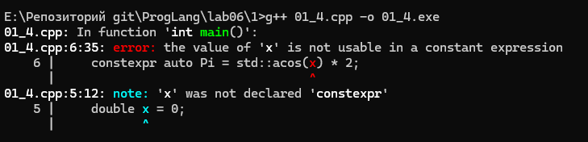

Программа не компилируется. Спецификатор constexpr требует константу этапа трансляции. А переменная x обычная, а не константная. Компилятор не может гарантировать ее значение на этапе трансляции.

### Задание 2 **(2)**
*Проверьте работу следующей программы на С++*
```
#include <iostream>
int main() {
   {
      int x, y;
      std::cin >> x >> y;
      std::cout << x+y << std::endl;
   }
   {
      double x, y;
      std::cin >> x >> y;
      std::cout << x+y << std::endl;
   }
   return 0;
}
```
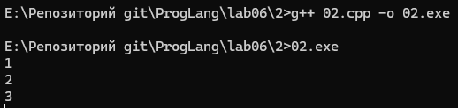

**Объяснение:**
* Вложенные фигурные скобки в этой программе обязательно нужны.
* Каждая пара скобок { ... } создает отдельную область видимости (блок).
* В первом блоке создаются переменные x и y типа int. В конце первого блока они уничтожаются.
* Во втором блоке создаются новые переменные с такими же именами x и y, но уже типа double.
* Если убрать фигурные скобки, все переменные окажутся в одном общем блоке функции main.
* В C++ нельзя дважды объявлять переменные с одинаковыми именами в одной области видимости. Без скобок программа не скомпилируется из-за ошибки повторного объявления.

### Задание 3 **(2)**
*Проверьте работу следующего фрагмента программы на С++.*
```
int s = 0;
for (int i = 0; i < 4; i++) {
   for (int i = 0; i < 3; i++) {
      s += i;
   } 
   s += i; 
}
std::cout << s;
```
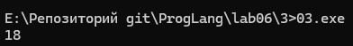

**Объяснение и процесс вычислений:**
* Программа выведет число 18.
* В C++ запись int i = 0 в заголовке цикла создает новую переменную i только для этого цикла.
* У внешнего и внутреннего циклов две разные переменные i, которые лежат по разным адресам в памяти.
* Внутри вложенного цикла внутренняя переменная i временно перекрывает (скрывает) внешнюю.
* Внутренний цикл всегда считает сумму от 0 до 2: 0 + 1 + 2 = 3.
* После выхода из внутреннего цикла снова видна внешняя переменная i. Она прибавляется в строке s += i;.
* **Расчет по шагам внешнего цикла:**
1. При внешнем i = 0: s = 0 + (0 + 1 + 2) + 0 = 3.
2. При внешнем i = 1: s = 3 + (0 + 1 + 2) + 1 = 7.
3. При внешнем i = 2: s = 7 + (0 + 1 + 2) + 2 = 12.
4. При внешнем i = 3: s = 12 + (0 + 1 + 2) + 3 = 18.

### Задание 4 **(2)**

*Проверьте работу следующего фрагмента программы на* **Python**.
```
s = 0
for i in range(4):
   for i in range(3):
      s += i
   s += i
print(s)
```
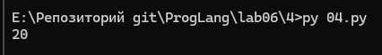

**Объяснение и процесс вычислений:**
* Программа выведет число 20.
* В Python цикл for не создает свою отдельную область видимости.
* Оба цикла работают с одной и той же переменной i.
* Внешний цикл запускается 4 раза.   
* На каждом шаге внутренний цикл меняет общую переменную i от 0 до 2 и прибавляет к s сумму 0 + 1 + 2 = 3.
* После завершения внутреннего цикла в переменной i остается последнее значение 2.
* Затем строка s += i всегда прибавляет 2, а не номер шага внешнего цикла.
* За один шаг внешнего цикла к s прибавляется 3 + 2 = 5.
* За 4 шага внешнего цикла получаем: 5 * 4 = 20.

**Различия между C++ и Python при работе с переменными:**
* В C++ переменная создается через явное указание типа (int i). Каждый блок { ... } и цикл for имеет свою собственную область видимости. Одноименная переменная во внутреннем блоке не портит переменную из внешнего блока.
* В Python переменные создаются в момент присваивания без указания типа. Циклы и условия не имеют собственной области видимости. Если во вложенном цикле использовать то же имя i, оно перезапишет переменную внешнего цикла.

### Задание 5 **(2)**

```
#include <iostream>

namespace BasicMath {
    int calculate(int a, int b) {
        return a + b;
    }
}

namespace AdvancedMath {
    int calculate(int a, int b) {
        return a * b;
    }
}

int main() {
    int x = 5, y = 4;
    std::cout << "Sum: " << BasicMath::calculate(x, y) << std::endl;
    std::cout << "Product: " << AdvancedMath::calculate(x, y) << std::endl;
    return 0;
}
```
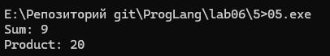

**Объяснение:**
* Пространства имен (namespace) нужны, чтобы группировать код и избегать конфликтов одинаковых имен.
* В примере созданы два пространства имен: BasicMath и AdvancedMath.
* В обоих есть функция с одинаковым именем calculate.
* Обращение к нужной функции происходит через оператор разрешения области видимости ::.

### Задание 6 **(2)**

*Рассмотрим следующий фрагмент программы. Эта программа 1000000 раз обменивает значения двух длинных 
строк с использованием третьей строки. Проверьте, насколько быстро она работает.*

```
std::string a(100000, 'a');
std::string b(100000, 'b');
for (int i=0;i<1000000;i++) {
   std::string c(a);
   a = b;
   b = c;
}
std::cout << a[0] << b[0];
```
*Попробуйте использовать для обмена значений строк функцию* **swap**. 

**Текст исправленной программы (06/06.cpp):**
```
#include <iostream>
#include <string>
#include <utility>

int main() {
    std::string a(100000, 'a');
    std::string b(100000, 'b');

    for (int i = 0; i < 1000000; i++) {
        std::string c(std::move(a));
        a = std::move(b);
        b = std::move(c);
    }

    std::cout << a[0] << b[0] << std::endl;
    return 0;
}
```
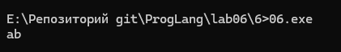

**Объяснение:**
* Скорость исходной программы: Исходная программа работает очень долго (несколько секунд).
* Использование std::swap(a, b): Если заменить тело цикла на std::swap(a, b);, программа выполняется мгновенно (доли секунды).
* В чем ошибка исходной программы: Переменные a, b и c относятся к категории lvalue (объекты с индивидуальностью в памяти). Для объектов lvalue операция присваивания выполняет полное копирование данных. На каждом шаге цикла программа 3 раза копирует по 100 000 символов в памяти.

### Задание 7 **(2)**

*Рассмотрим программу на языке* **Python**.
```
a = 'Hello world'
print(a, id(a))
b = a
print(b, id(b))
a += ' and goodbye'
print(a, id(a))
print(b, id(b))
```
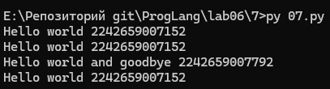

**Объяснение:**
* Функция id() возвращает уникальный номер объекта. В стандартном Python это адрес объекта в оперативной памяти.   
* Строки в Python являются неизменяемыми объектами.
* Момент 1 (a = 'Hello world'): В памяти создается первая строка 'Hello world'. Переменная a хранит ссылку на нее.   
* Момент 2 (b = a): Новая строка не создается. Переменная b копирует ссылку из a и указывает на ту же самую строку в памяти. Поэтому id(a) и id(b) одинаковые.   
* Момент 3 (a += ' and goodbye'): Создается строка ' and goodbye', а затем при склеивании создается совершенно новая строка 'Hello world and goodbye' по новому адресу. Переменная a теперь ссылается на новый объект, поэтому id(a) изменился.   
* Переменная b осталась привязанной к старой строке 'Hello world', и ее id(b) не изменился.   

### Задание 8 **(2)**

**Текст программы:**
```
a = 'Hello'
b1, b2 = a, a[:]
print(b1 is b2)
```
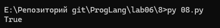

**Объяснение:**
* Оператор is проверяет, совпадают ли адреса в памяти.   
* Результат True доказывает, что для строк разницы нет.   
* Строки в Python неизменяемы. Поэтому срез a[:] не создает копию, а возвращает ссылку на исходную строку.   

###  Задание 9 **(3)**

**Текст программы:**
```
import string

val = 1
for letter in string.ascii_lowercase:
    for num in range(100):
        var_name = f"{letter}{num}"
        globals()[var_name] = val
        val += 1

print("a0 =", a0)
print("a99 =", a99)
print("b0 =", b0)
print("z99 =", z99)
```
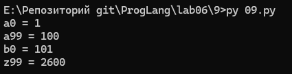

**Объяснение:**
* Встроенная функция globals() в Python возвращает словарь всех глобальных переменных текущей программы.
* Ключами этого словаря являются имена переменных в виде строк, а значениями - сами значения переменных.
* Во внешнем цикле перебираются все 26 строчных букв английского алфавита от 'a' до 'z'.
* Во внутреннем цикле перебираются числа от 0 до 99.
* Строка globals()[var_name] = val напрямую добавляет новую переменную в глобальную область видимости и присваивает ей уникальное число от 1 до 2600.   
