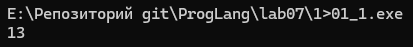
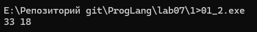
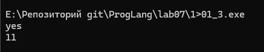
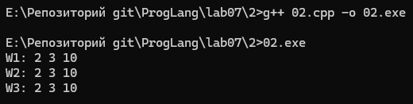
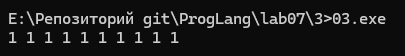
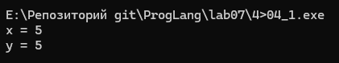
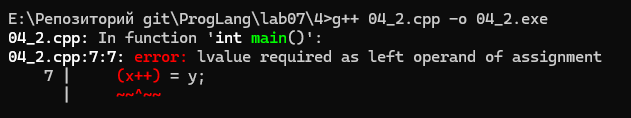
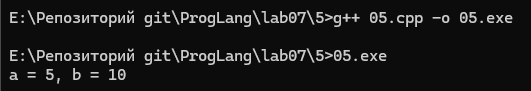
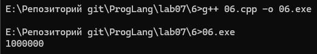
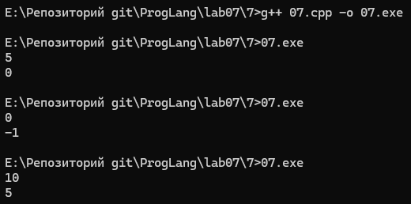

# Отчет по лабораторной работе
## Лабораторная работа 7

### Задание 1 **(2)**

**Фрагмент 1 (`01_1.cpp`):**
```cpp
#include <iostream>
#include <algorithm>

int main() {
    int x = 10, y = 3;
    std::cout << std::min(x = 15, x + y) << std::endl;
    return 0;
}
```


**Фрагмент 2 (`01_2.cpp`):**
```cpp
#include <iostream>

int main() {
    int x = 10, y = 3;
    x = 15, y += x, x += y;
    std::cout << x << " " << y << std::endl;
    return 0;
}
```


**Фрагмент 3 (`01_3.cpp`):**
```cpp
#include <iostream>

int main() {
    int x = 10, y = 9;
    if (x > y++ && y++ > 9)
        std::cout << "yes" << std::endl;
    std::cout << y << std::endl;
    return 0;
}
```


#### Оценка и объяснение:

1. **Фрагмент 1 (`std::min(x=15, x+y)`):**
   * Обладает **неоднозначным (неопределенным) поведением**.
   * По правилам языка C++ параметры функции вычисляются до ее вызова. Но порядок вычисления самих параметров не определен стандартом.
   * Первый аргумент `x=15` имеет побочное действие и меняет `x`. Второй аргумент `x+y` читает `x`.
   * Если сначала вычислится `x=15`, то функция сравнит `15` и `18` и вернет `15`. Если сначала вычислится `x+y`, то функция сравнит `15` и `13` и вернет `13`.

2. **Фрагмент 2 (`x=15, y+=x, x+=y;`):**
   * Работает **однозначно**.
   * Здесь используется оператор запятая `,`.
   * Для оператора запятая левый операнд всегда вычисляется строго до правого операнда. Все побочные действия также завершаются по очереди слева направо.
   * Сначала `x` становится равен `15`. Затем `y` становится равен $3 + 15 = 18$. В конце `x` становится равен $15 + 18 = 33$.

3. **Фрагмент 3 (`if (x>y++ && y++>9)`):**
   * Работает **однозначно**.
   * Логический оператор `&&` всегда вычисляет операнды строго слева направо.
   * Сначала проверяется левое условие `x > y++`. Сравнивается $10 > 9$ (истина), и сразу после этого `y` увеличивается до `10`.
   * Так как левая часть истинна, вычисляется правая часть `y++ > 9`. Сравнивается $10 > 9$ (истина), после чего `y` увеличивается до `11`.
   * Программа всегда выведет `yes` и число `11`.

---

### Задание 2 **(2)**

Исходные строки:
```cpp
x = x + 1;
z = z + 2 * x + 3 * y;
y = y + 1;
```

#### Cпособы:
```cpp
#include <iostream>

int main() {
    int x1 = 1, y1 = 2, z1 = 0;
    z1 += 2 * (++x1) + 3 * (y1++);
    std::cout << "W1: " << x1 << " " << y1 << " " << z1 << std::endl;

    int x2 = 1, y2 = 2, z2 = 0;
    ++x2, z2 += 2 * x2 + 3 * y2, ++y2;
    std::cout << "W2: " << x2 << " " << y2 << " " << z2 << std::endl;

    int x3 = 1, y3 = 2, z3 = 0;
    z3 += 2 * (x3 += 1) + 3 * ((y3 += 1) - 1);
    std::cout << "W3: " << x3 << " " << y3 << " " << z3 << std::endl;

    return 0;
}
```


#### Объяснение:
* **В способе 1:** префиксный инкремент `++x` сначала увеличивает `x` на $1$, а затем дает новое значение для умножения на $2$. Суффиксный инкремент `y++` отдает старое значение `y` для умножения на $3$, а затем увеличивает `y` на $1$. Переменные `x` и `y` входят в выражение только по одному разу, поэтому поведение полностью однозначно.
* **В способе 2:** оператор запятая `,` объединяет три действия в одно выражение и выполняет их строго слева направо.

---

### Задание 3 **(2)**

#### Результат:
```cpp
#include <iostream>
#include <vector>

int main() {
    std::vector<int> x(10);
    for (int i = -1; i < 9;)
        x[++i] = 1;

    for (int val : x)
        std::cout << val << " ";
    std::cout << std::endl;
    return 0;
}
```


#### Объяснение:
* Префиксный инкремент `++i` увеличивает переменную `i` до обращения к элементу вектора.
* Чтобы первым заполнился элемент с индексом `0`, счетчик `i` должен начинаться со значения `-1`.
* Когда `i` равно `8`, условие `i < 9` выполняется в последний раз. В теле цикла `++i` делает `i` равным `9` и записывает единицу в последний элемент `x[9]`.
* На следующем шаге `i` равно `9`, условие `9 < 9` ложно, и цикл завершается.

---

### Задание 4 **(2)**

**(++x)=y:**
```cpp
#include <iostream>

int main() {
    int x = 1;
    int y = 5;

    (++x) = y;

    std::cout << "x = " << x << std::endl;
    std::cout << "y = " << y << std::endl;

    return 0;
}
```


**(x++)=y:**
```cpp
#include <iostream>

int main() {
    int x = 1;
    int y = 5;

    (x++) = y;

    std::cout << "x = " << x << std::endl;

    return 0;
}
```


#### Сообщение об ошибке компилятора (GCC):
* **Текст ошибки:** `error: lvalue required as left operand of assignment`
* **Перевод:** `ошибка: в качестве левого операнда присваивания требуется lvalue`

#### Объяснение:
* Оператор присваивания `=` требует, чтобы слева от него находился изменяемый объект категории `lvalue` (объект, имеющий постоянный адрес в памяти).
* **Префиксный инкремент `++x`** сначала увеличивает переменную `x` на единицу и возвращает саму переменную `x` категории `lvalue`. Поэтому в нее можно записать значение `y`.
* **Суффиксный инкремент `x++`** возвращает старое значение `x` в виде временного значения категории `rvalue` (`prvalue`). У временного значения нет своего места в памяти. Записать в него новое значение нельзя, поэтому компилятор выдает ошибку.

---

### Задание 5 **(2)**

#### Программа для проверки:
```cpp
#include <iostream>

int main() {
    int a = 5, b = 10;
    a, b = b, a;
    std::cout << "a = " << a << ", b = " << b << std::endl;
    return 0;
}
```


#### Ответ и объяснение:
* **Синтаксическая правильность:** Строка `a, b = b, a;` в C++ является синтаксически правильной и компилируется без ошибок.
* **Обмен значений:** В Python запись a, b = b, a работает потому, что язык умеет автоматически объединять значения справа в пару и сразу раскладывать их по переменным слева.  
​В C++ такого встроенного механизма для готовых переменных нет. Запятая в C++ - это отдельный оператор, который просто выполняет действия по очереди и оставляет только правое значение. Поэтому для обмена значений в C++ стандартно вызывают функцию std::swap(a, b)
* **Как вычисляется выражение в C++:**
  1. Оператор запятая `,` имеет самый низкий приоритет. Его приоритет ниже, чем у оператора присваивания `=`.
  2. Компилятор расставляет приоритеты так: `a, (b = b), a;`.
  3. Сначала вычисляется левое выражение `a` (ничего не делает).
  4. Затем выполняется `b = b` (переменная `b` присваивается сама себе).
  5. В конце вычисляется правое выражение `a`, которое становится общим результатом всей строки. Переменные `a` и `b` остаются со своими старыми значениями.

---

### Задание 6 **(2)**

#### Программа:
```cpp
#include <iostream>
#include <string>

int main() {
    std::string s;
    for (int i = 0; i < 1000000; i++)
        s += 'a';
    std::cout << s.size() << std::endl;
    return 0;
}
```


#### Объяснение результата:
* Вывод программы не изменится (обе версии выведут `1000000`).
* Сильно изменится **время работы программы**.
* **Вариант `s += 'a'`:** работает мгновенно. Оператор `+=` изменяет существующую строку `s` на месте и просто дописывает один символ `'a'` в конец буфера памяти.
* **Вариант `s = s + 'a'`:** работает очень медленно (несколько десятков секунд или минут). Оператор `+` на каждом шаге цикла создает новую временную строку, копирует в нее все старые символы из `s`, добавляет `'a'` и переносит результат обратно в `s`. За миллион шагов программа копирует сотни миллиардов символов.

---

### Задание 7 **(2)**

#### Программа:
```cpp
#include <iostream>

int main() {
    int x;
    std::cin >> x;
    x-->0 && x-->0 && x-->0 && x-->0 && x-->0;
    std::cout << x << std::endl;
    return 0;
}
```


#### Объяснение работы:
* Запись `x-->0` компилятор разбирает как два отдельных оператора: `(x--) > 0`.
* Это сравнение текущего значения `x` с нулем и суффиксный декремент `x--`, который уменьшает `x` на $1$ после взятия значения для сравнения.
* Логический оператор `&&` вычисляет части выражения строго слева направо.
* Для оператора `&&` действует правило сокращенного вычисления (тождество поглощения): как только одно из условий становится ложным (`false`), все остальные правые части не вычисляются, и их побочные действия не происходят.

#### Зависимость результата от исходного значения `x`:
1. **Если $x \ge 5$:** все 5 проверок дают истину. Переменная `x` уменьшается на единицу 5 раз. Программа выведет $x - 5$.
2. **Если $0 \le x < 5$:** первые $x$ проверок дадут истину и уменьшат `x` до `0`. На следующей проверке условие `0 > 0` даст ложь, но декремент `x--` для этой проверки успеет выполниться и сделает `x` равным `-1`. Остальные проверки справа выполняться не будут. Программа всегда выведет **`-1`**.
3. **Если $x < 0$:** самая первая проверка `x > 0` сразу даст ложь. Переменная `x` уменьшится ровно один раз. Остальные 4 части не запустятся. Программа выведет $x - 1$.

---

### Задание 8 **(3)**

```cpp
int s = 0;
for (int i = 0, j = 5; i + j <= 16; (i < j ? i : j)++)
   (s += i) += j;
std::cout << s;
```

1. **Тело цикла `(s += i) += j;`:**
   Оператор `+=` возвращает ссылку категории `lvalue` на переменную `s`. Поэтому сначала к `s` прибавляется `i`, а затем к этой же переменной `s` прибавляется `j`. За один шаг цикла `s` увеличивается на сумму `i + j`.
2. **Шаг цикла `(i < j ? i : j)++`:**
   Тернарный оператор возвращает `lvalue` той переменной, которая меньше (если `i == j`, то возвращается `j`). Затем оператор `++` увеличивает выбранную переменную на $1$.
3. Таким образом, на каждом шаге цикла ровно одна из переменных (`i` или `j`) увеличивается на $1$. Значит, их сумма `i + j` на каждом шаге тоже увеличивается ровно на $1$ (от $5$ до $16$ включительно).

#### Процесс вычислений по шагам:
* **Шаг 1:** $i = 0, j = 5$. Сумма $i + j = 5 \le 16$. $s = 0 + 5 = 5$. Так как $0 < 5$, растет $i \rightarrow i = 1, j = 5$.
* **Шаг 2:** $i = 1, j = 5$. Сумма $i + j = 6 \le 16$. $s = 5 + 6 = 11$. Так как $1 < 5$, растет $i \rightarrow i = 2, j = 5$.
* **Шаг 3:** $i = 2, j = 5$. Сумма $i + j = 7 \le 16$. $s = 11 + 7 = 18$. Так как $2 < 5$, растет $i \rightarrow i = 3, j = 5$.
* **Шаг 4:** $i = 3, j = 5$. Сумма $i + j = 8 \le 16$. $s = 18 + 8 = 26$. Так как $3 < 5$, растет $i \rightarrow i = 4, j = 5$.
* **Шаг 5:** $i = 4, j = 5$. Сумма $i + j = 9 \le 16$. $s = 26 + 9 = 35$. Так как $4 < 5$, растет $i \rightarrow i = 5, j = 5$.
* **Шаг 6:** $i = 5, j = 5$. Сумма $i + j = 10 \le 16$. $s = 35 + 10 = 45$. Условие $5 < 5$ ложно, растет $j \rightarrow i = 5, j = 6$.
* **Шаг 7:** $i = 5, j = 6$. Сумма $i + j = 11 \le 16$. $s = 45 + 11 = 56$. Так как $5 < 6$, растет $i \rightarrow i = 6, j = 6$.
* **Шаг 8:** $i = 6, j = 6$. Сумма $i + j = 12 \le 16$. $s = 56 + 12 = 68$. Условие $6 < 6$ ложно, растет $j \rightarrow i = 6, j = 7$.
* **Шаг 9:** $i = 6, j = 7$. Сумма $i + j = 13 \le 16$. $s = 68 + 13 = 81$. Так как $6 < 7$, растет $i \rightarrow i = 7, j = 7$.
* **Шаг 10:** $i = 7, j = 7$. Сумма $i + j = 14 \le 16$. $s = 81 + 14 = 95$. Условие $7 < 7$ ложно, растет $j \rightarrow i = 7, j = 8$.
* **Шаг 11:** $i = 7, j = 8$. Сумма $i + j = 15 \le 16$. $s = 95 + 15 = 110$. Так как $7 < 8$, растет $i \rightarrow i = 8, j = 8$.
* **Шаг 12:** $i = 8, j = 8$. Сумма $i + j = 16 \le 16$. $s = 110 + 16 = 126$. Условие $8 < 8$ ложно, растет $j \rightarrow i = 8, j = 9$.
* **Проверка выхода:** $i = 8, j = 9$. Сумма $i + j = 17 > 16$. Цикл завершается.

**Ответ:** программа выводит число **126**.

---
